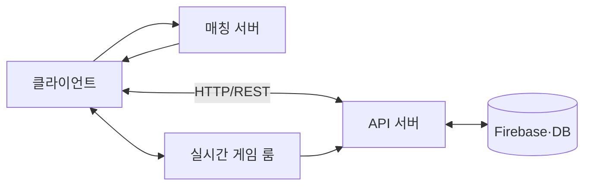

# Level 9 클라이언트 서버 통신과 멀티플레이 발표 슬라이드 목차

## 구성 원칙

- 앞 100분은 서버 타입, 통신 방식, 권한 구조를 중심으로 설명한다.
- AI는 구조 초안의 누락을 찾고 검증표를 만드는 20분짜리 보조 도구로 다룬다.
- 모든 설명은 소규모(2~5인) 협동/경쟁 게임의 로그인 → 로비 → 매칭 → 게임 룸 → 결과 저장 사례로 연결한다.

## 슬라이드 구성

| 순서 | 슬라이드 제목 | 핵심 메시지 | 권장 시간 |
| --- | --- | --- | --- |
| 1 | 오늘의 게임 흐름 | 전체 온라인 흐름을 먼저 본다. | 3분 |
| 2 | 누가 무엇을 책임지는가 | 클라이언트와 서버의 역할을 나눈다. | 7분 |
| 3 | 서버 타입 한눈에 보기 | API·매칭·실시간·전용 게임 서버·DB의 차이 | 8분 |
| 4 | API 서버 | 로그인, 프로필, 결과 저장은 요청·응답 업무다. | 8분 |
| 5 | 매칭 서버와 게임 룸 | 매칭은 방 배정, 게임 룸은 실제 플레이 연결이다. | 8분 |
| 6 | 실시간 릴레이와 전용 게임 서버 | 전달 서버와 판정 서버를 구분한다. | 8분 |
| 7 | 데이터 저장소와 캐시 | DB·캐시·Firebase의 역할을 구분한다. | 6분 |
| 8 | 연결지향 통신 TCP | 정확한 전달과 순서가 필요한 데이터 | 7분 |
| 9 | 비연결지향 통신 UDP | 최신성이 중요한 실시간 데이터 | 8분 |
| 10 | HTTP REST와 WebSocket | API 요청과 지속 연결 기반 이벤트를 구분한다. | 10분 |
| 11 | Firebase에 저장할 데이터 | 지속 데이터와 권한·중복 저장 | 7분 |
| 12 | 기본 매칭 상태도 | 신청부터 게임 시작까지의 상태 | 8분 |
| 13 | 매칭 예외와 테스트 | 취소·이탈·타임아웃·중복 요청 | 7분 |
| 14 | 실시간 데이터와 최적화 | 입력·상태·이벤트, 갱신 주기와 대상 | 8분 |
| 15 | Firebase 매칭 데모 | 두 브라우저의 상태 변화를 확인한다. | 5분 |
| 16 | AI로 구조 초안 검토 | 책임표와 예외 목록의 초안을 만든다. | 10분 |
| 17 | AI 결과 검증 | 공식 문서와 테스트로 가정을 검증한다. | 10분 |
| 18 | 질의응답 안내 | 사례를 서버 구조 관점에서 함께 검토한다. | 2분 |

## 전체 구조 예시

## 진행 메모

- TCP·UDP와 HTTP·WebSocket을 같은 계층의 용어처럼 설명하지 않는다.
- “Photon 또는 실시간 룸이 있다”와 “서버가 공정하게 승패를 판정한다”는 별개임을 강조한다.
- `ai_시연/index.html`은 Firebase Realtime Database의 상태 변경을 보여 주는 보조 데모로 사용한다.
