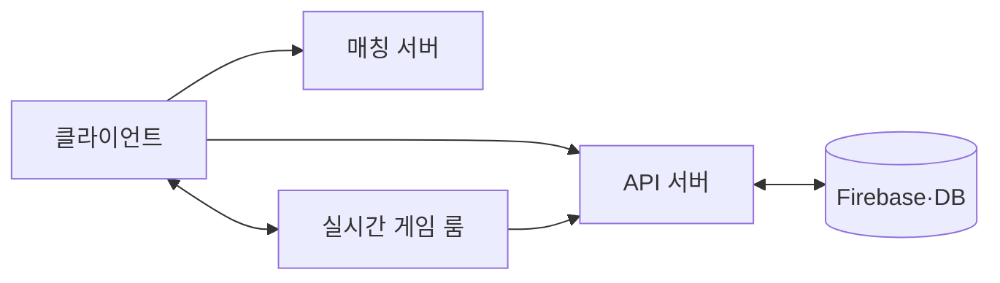
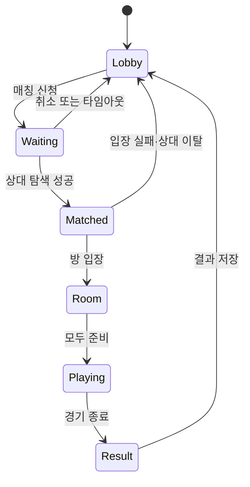

# Level 9 클라이언트 서버 통신과 멀티플레이

발표용 슬라이드 원고다. 화면에는 핵심 문장·도표만 남기고 설명은 발표 메모로 진행한다.

---

## 1. 오늘의 게임 흐름

### 화면 문구

**로그인 → 프로필 로드 → 로비 → 매칭 → 게임 룸 → 결과 저장**

소규모(2~5인) 협동/경쟁 게임을 사례로 서버와 데이터의 흐름을 본다.

### 발표 메모

- 오늘의 핵심은 SDK 사용법보다 구조다.
- 같은 흐름을 기획자는 규칙으로, 클라이언트 개발자는 화면과 입력으로, 서버 개발자는 권한·데이터·장애 처리로 본다.

---

## 2. 누가 무엇을 책임지는가

### 화면 문구

| 주체 | 주된 책임 |
| --- | --- |
| 클라이언트 | 화면, 입력, 로컬 표현 |
| 서버 | 요청 처리, 상태 관리, 권한 검증 |
| DB·Firebase | 다시 접속해도 남는 데이터 |

### 발표 메모

- 클라이언트가 보여 주는 값과 서버가 확정한 값은 다를 수 있다.
- “누가 결과를 확정하는가?”가 서버 구조를 결정하는 가장 중요한 질문이다.

---

## 3. 서버 타입 한눈에 보기

### 화면 문구



| 서버 또는 구성 요소 | 한 줄 역할 |
| --- | --- |
| API 서버 | 요청을 받아 업무를 처리하고 응답한다. |
| 매칭 서버 | 대기열을 관리하고 게임 룸을 배정한다. |
| 실시간 게임 룸 | 게임 중 이벤트와 상태를 교환한다. |
| 전용 게임 서버 | 게임 상태와 승패를 권한 있게 확정한다. |

### 발표 메모

- 실제 프로젝트에서는 이 역할들이 하나의 서비스에 합쳐질 수도 있다.
- 이름보다 책임과 데이터 흐름을 먼저 분리한다.

---

## 4. API 서버는 요청과 응답을 처리한다

### 화면 문구

```text
클라이언트 → POST /login     → API 서버 → 인증·프로필 확인
클라이언트 → GET /profile    → API 서버 → 프로필 반환
클라이언트 → POST /result    → API 서버 → 결과 검증·저장
```

### 발표 메모

- API 서버는 로그인, 프로필, 인벤토리, 상점, 전적, 보상처럼 즉시 답을 받는 업무에 적합하다.
- 같은 요청이 두 번 도착해도 보상이 두 번 지급되지 않게 설계해야 한다.
- API는 주소보다 요청 데이터, 성공 응답, 실패 응답, 권한 조건을 함께 정하는 문서다.

---

## 5. 매칭 서버와 게임 룸은 다르다

### 화면 문구

```text
매칭 서버: 대기열 등록 → 조건 비교 → 방 ID 배정
게임 룸: 방 입장 → 준비 → 실제 게임 데이터 교환
```

### 발표 메모

- 매칭 서버의 목표는 같은 조건의 사용자를 빠르게 묶어 방에 넣는 것이다.
- 게임 룸의 목표는 매칭된 사용자들이 플레이하도록 연결을 유지하는 것이다.
- 매칭 확정과 취소가 동시에 일어날 때 어느 상태를 최종으로 인정할지 정한다.

---

## 6. 실시간 릴레이와 전용 게임 서버

### 화면 문구

| 구조 | 판정 주체 | 적합한 상황 |
| --- | --- | --- |
| 실시간 릴레이 룸 | 클라이언트 또는 호스트 | 캐주얼 협동, 빠른 프로토타입 |
| 전용 게임 서버 | 서버 | 경쟁 PvP, 랭킹, 치팅 방지 |

### 발표 메모

- 릴레이는 메시지를 전달한다고 해서 서버가 게임 규칙을 판정하는 것은 아니다.
- 전용 게임 서버는 서버가 게임 루프를 실행하고, 피격·점수·승패를 최종 확정한다.
- 비용과 구현 난도는 늘지만, 공정성과 검증 능력이 높아진다.

---

## 7. DB, 캐시, Firebase의 역할

### 화면 문구

| 구성 요소 | 적합한 데이터 |
| --- | --- |
| DB·Firebase | 계정, 프로필, 전적, 보상, 구매 기록 |
| 캐시 | 세션, 대기열, 짧게 유지할 룸 상태 |
| 실시간 룸 | 입력, 위치, 준비 상태, 순간 이벤트 |

### 발표 메모

- Firebase는 인증과 클라우드 데이터 관리에 유용하다.
- 실시간 게임 데이터를 모두 영구 DB에 기록하려 하면 비용과 지연이 커질 수 있다.
- 캐시는 빠르지만 사라질 수 있으므로, 무엇을 영구 저장할지 구분한다.

---

## 8. 연결지향 통신: TCP

### 화면 문구

**연결을 만들고 유지하며, 순서와 전달을 보장한다.**

- 로그인
- 프로필·인벤토리
- 구매·보상
- 경기 결과 저장

### 발표 메모

- TCP는 손실된 데이터를 재전송하고 순서를 맞춘다.
- 정확한 전달이 필요한 데이터에 적합하다.
- 이전 데이터가 지연되면 뒤 데이터도 기다릴 수 있으므로, 빠르게 변하는 위치값에 무조건 적합한 것은 아니다.

---

## 9. 비연결지향 통신: UDP

### 화면 문구

**각 패킷은 독립적으로 전송된다. 최신 데이터가 더 중요할 때 사용한다.**

- 이동 입력
- 위치 스냅샷
- 빠른 액션의 게임 상태

### 발표 메모

- UDP는 전달·순서·중복 제거를 기본 보장하지 않는다.
- 게임은 순서 번호, 보간, 예측, 필요한 데이터만 선택 재전송하는 방식으로 이를 보완한다.
- 1초 전 위치를 완벽히 받는 것보다 현재 위치를 빠르게 받는 편이 나은 경우에 적합하다.

---

## 10. HTTP REST와 WebSocket

### 화면 문구

| 방식 | 목적 | 예시 |
| --- | --- | --- |
| HTTP REST | 요청 후 응답 | 프로필 조회, 결과 저장 |
| WebSocket | 지속 연결과 양방향 이벤트 | 로비 알림, 채팅, 준비 상태 |
| UDP 기반 통신 | 짧은 패킷의 빠른 전달 | 이동·입력·스냅샷 |

### 발표 메모

- TCP와 UDP는 전송 계층 용어다.
- HTTP·REST·WebSocket은 응용 프로그램이 데이터를 주고받는 방식이다.
- 따라서 “REST와 UDP 중 무엇을 쓸까?”가 아니라 “어떤 데이터에 어떤 전달 특성이 필요한가?”를 먼저 묻는다.

---

## 11. Firebase에는 무엇을 저장할까

### 화면 문구

**게임을 껐다 켜도 남아야 하는 데이터**

- 사용자 ID와 프로필
- 인벤토리와 설정
- 전적과 보상 지급 기록
- 검증된 경기 결과

### 발표 메모

- Firebase는 지속 데이터와 인증을 설명하기 좋은 예시다.
- 보상이나 전적은 클라이언트가 원하는 값을 직접 저장하게 두면 안 된다.
- 권한 규칙과 중복 처리 기준을 함께 설계한다.

---

## 12. 기본 매칭 상태도

### 화면 문구



### 발표 메모

- 상태도는 기획·클라이언트·서버가 같은 기능을 합의하는 도구다.
- 각 화살표마다 요청 주체, 최종 확정 주체, 실패 메시지를 정한다.

---

## 13. 매칭 예외와 테스트

### 화면 문구

- 대기 중 취소
- 동시에 들어온 취소와 매칭 확정
- 매칭 직후 상대 이탈
- 중복 매칭 요청
- 방 입장 실패와 재시도

### 발표 메모

- 정상 매칭만 구현하면 실제 서비스에서는 곧 예외를 만나게 된다.
- 테스트는 “어떤 오류가 발생했나?”보다 “최종 상태가 무엇이어야 하나?”부터 정한다.

---

## 14. 실시간 데이터와 최적화

### 화면 문구

**필요한 데이터만 · 필요한 대상에게 · 필요한 주기로**

| 데이터 | 예시 |
| --- | --- |
| 입력 | 이동, 공격, 선택 |
| 상태 | 위치, 체력, 점수 |
| 이벤트 | 피격, 이모트, 알림 |

### 발표 메모

- 변하지 않은 상태를 매번 전송하지 않는다.
- 시야 밖 또는 멀리 있는 플레이어는 덜 자주 갱신할 수 있다.
- 이벤트와 현재 상태를 구분하면 늦은 입장자 처리도 쉬워진다.

---

## 15. Firebase 매칭 데모

### 화면 문구

```text
첫 번째 사용자: 매칭 신청 → waiting
두 번째 사용자: 매칭 신청 → match 생성
두 화면: 상태 변경을 실시간 수신
```

### 발표 메모

- `ai_시연/index.html`을 일반 창과 시크릿 창에서 연다.
- 첫 사용자와 두 번째 사용자가 같은 데이터를 보고 상태가 바뀌는 모습을 확인한다.
- 이 코드는 상태 전환을 보여 주는 수업용 예제다. 전용 게임 서버나 운영용 매칭 완성본은 아니다.

---

## 16. AI로 구조 초안 검토하기

### 화면 문구

**AI에게 구조를 결정하게 하지 말고, 빠진 질문을 찾게 한다.**

요청에 포함할 내용:

- 경기 인원과 장르
- 서버별 책임
- 지속 저장·실시간 데이터
- 권한과 예외 상황
- 원하는 결과물 형식

### 발표 메모

- 예: “서버 책임표, API 목록, 매칭 상태, 테스트 시나리오를 만들고 가정을 구분해줘.”
- 답을 정답으로 받아들이지 말고 팀 검토의 시작점으로 사용한다.

---

## 17. AI 답변 검증

### 화면 문구

| 확인할 것 | 검증 방법 |
| --- | --- |
| 서버 책임 | 실제 기획·구조와 대조 |
| 기술 기능 | 공식 문서 확인 |
| 권한·보안 | 규칙과 권한 테스트 |
| 예외 처리 | 취소·이탈·재접속 테스트 |

### 발표 메모

- AI가 말한 TCP·UDP·Firebase·Photon 관련 설명은 제품 문서와 실제 실행으로 확인한다.
- 특히 “서버가 판정한다”는 주장에는 실제 권한 주체가 누구인지 다시 묻는다.

---

## 18. 질의응답

### 화면 문구

질문할 때 알려 주세요.

1. 현재 게임과 경기 인원
2. 저장·매칭·실시간·판정 중 막힌 지점
3. 사용 중인 엔진·서비스와 제약

### 발표 메모

- 각 사례에 대해 서버 책임, 통신 방식, 데이터 권한 순서로 함께 검토한다.
