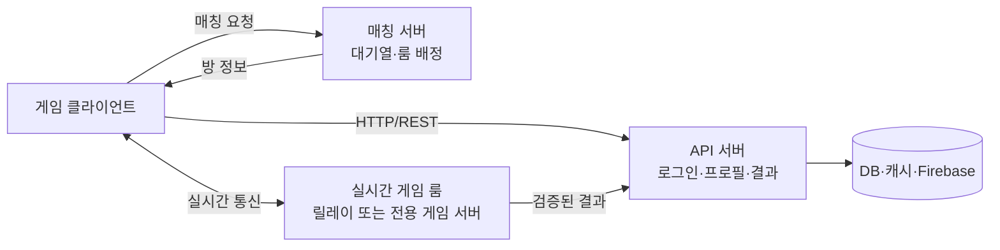

# 서버 타입과 통신 방식 핸드아웃

## 1. 소규모 2~5인 협동/경쟁 게임의 기본 구조

작은 프로젝트에서는 여러 역할이 하나의 서비스에 함께 있을 수 있다. 서비스 이름보다 역할과 권한을 먼저 구분한다.

## 2. 서버 타입별 역할

| 구성 요소 | 주 역할 | 예시 요청 또는 데이터 | 주의할 점 |
| --- | --- | --- | --- |
| API 서버 | 요청·응답 처리 | 로그인, 프로필 조회, 인벤토리 변경, 전적 저장 | 중복 요청, 인증·인가, 오류 응답 |
| 인증 서버 | 사용자 신원 확인 | 로그인 토큰 발급·검증 | 클라이언트가 사용자 ID를 임의로 정하게 두지 않기 |
| 매칭 서버 | 조건에 맞는 사용자 묶기 | 대기열 등록, 취소, 방 배정 | 취소와 확정의 경합, 타임아웃, 이탈 |
| 실시간 릴레이 서버 | 룸 내 메시지 전달 | 입력, 위치, 준비 상태, 이벤트 | 데이터 크기, 갱신 빈도, 수신 대상 |
| 전용 게임 서버 | 권한 있는 게임 시뮬레이션 | 피격, 점수, 승패, 게임 시간 | 운영 비용, 서버 배포, 재접속·장애 복구 |
| DB | 영구 데이터 보관 | 프로필, 전적, 보상, 구매 내역 | 스키마, 트랜잭션, 백업 |
| 캐시 | 빠른 임시 데이터 | 세션, 대기열, 룸 상태, 순위 일부 | 만료 시간과 DB 정합성 |
| Firebase | BaaS 기반 기능 | 인증, 문서 데이터, 실시간 DB, 푸시 | 권한 규칙, 비용, 고빈도 게임 상태와의 분리 |

## 3. 연결지향과 비연결지향

| 구분 | 연결지향 통신 | 비연결지향 통신 |
| --- | --- | --- |
| 대표 전송 방식 | TCP | UDP |
| 연결 | 통신 전 연결을 만들고 유지 | 각 패킷을 독립적으로 전송 |
| 전달 보장 | 손실 시 재전송, 순서 보장 | 손실·중복·순서 변경이 가능 |
| 장점 | 구현이 단순하고 정확한 데이터 전달에 유리 | 지연을 줄이고 오래된 데이터를 버리기 쉬움 |
| 적합한 데이터 | 로그인, 결제, 프로필, 채팅, 결과 저장 | 이동 입력, 위치 스냅샷, 빠른 액션 게임 상태 |
| 고려할 점 | 지연된 이전 데이터가 뒤 데이터를 막을 수 있음 | 순서 번호, 보간, 필요한 재전송을 앱이 설계해야 함 |

TCP와 UDP는 전송 계층의 선택이다. HTTP, WebSocket, REST는 애플리케이션이 데이터를 주고받는 방식이므로 혼동하지 않는다.

## 4. API와 실시간 통신

| 방식 | 연결 형태 | 흔한 사용처 | 예시 |
| --- | --- | --- | --- |
| HTTP/REST | 요청 후 응답 | 계정·상점·전적·보상 | `GET /profile`, `POST /match/result` |
| WebSocket | 하나의 지속 연결 | 로비 알림, 채팅, 룸 이벤트 | 준비 상태 변경, 매칭 완료 알림 |
| UDP 기반 메시지 | 패킷 단위 전송 | 빠른 입력·위치·스냅샷 | 이동 방향, 캐릭터 위치 |
| 서버 간 메시지 큐 | 서비스 간 비동기 전달 | 결과 저장, 알림, 로그 처리 | 플레이 종료 이벤트 전달 |

HTTP/REST는 “현재 결과를 돌려받는 요청”에, WebSocket은 “서버와 클라이언트가 계속 연결된 채 알림을 주고받는 상황”에 어울린다. UDP 기반 방식은 손실돼도 최신 데이터로 빠르게 덮어쓸 수 있는 데이터에 어울린다.

## 5. 누가 게임 결과를 확정하는가

| 구조 | 판정 주체 | 장점 | 위험 또는 비용 |
| --- | --- | --- | --- |
| 클라이언트 주도 | 플레이어 클라이언트 | 빠르게 만들기 쉽다 | 조작과 불일치에 약하다 |
| 호스트 클라이언트 | 방장 역할의 클라이언트 | 별도 서버 비용이 적다 | 호스트 이탈·호스트 조작 위험 |
| 릴레이 룸 | 각 클라이언트가 공유 상태 처리 | 소규모 협동에 단순하다 | 권한 있는 판정 서버가 아니다 |
| 전용 게임 서버 | 서버 | 공정한 판정과 검증에 유리 | 서버 호스팅과 운영 필요 |

전적, 보상, 랭킹처럼 서비스 가치에 영향을 주는 결과는 신뢰할 수 있는 서버 또는 백엔드 검증을 거친 뒤 저장하는 것이 원칙이다.

## 6. 설계 순서

1. 플레이 인원, 장르, 지연에 민감한 행동을 정한다.
2. 지속 데이터·매칭 데이터·실시간 데이터를 나눈다.
3. 각 데이터의 확정 주체와 저장 위치를 정한다.
4. API 요청과 실시간 메시지를 따로 나열한다.
5. 취소, 이탈, 재접속, 중복 요청, 저장 실패를 상태도로 검토한다.
6. 최소 인원으로 실제 접속·지연·이탈 테스트를 한다.
