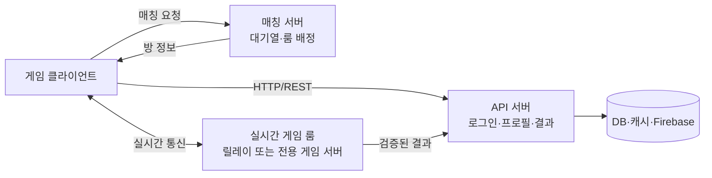
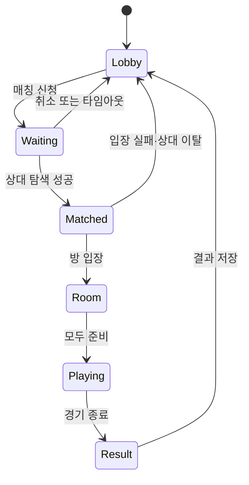

# 클라이언트 서버 통신과 멀티플레이 핸드아웃

슬라이드에는 핵심 문장과 그림만 있고, 이 자료에는 자세한 비교표가 있다. 발표 중 **[핸드아웃 §N]** 표시가 나오면 해당 표를 함께 본다.

| 강의 파트 | 슬라이드 | 핸드아웃 |
| --- | --- | --- |
| PART 1 클라이언트와 서버 기초 | 1~5 | §1 |
| PART 2 서버 구성 요소 | 6~9 | §2 · §3 · §4 |
| PART 3 데이터 저장 | 10~11 | §5 |
| PART 4 통신 방식과 실시간 데이터 | 12~15 | §6 · §7 · §8 |
| PART 5 매칭 설계 | 16~17 | §9 |
| 강의 뒤 팀별 정리 | — | §10 |

## 1. 클라이언트와 서버 기초

클라이언트는 요청하고 보여 주며, 서버는 요청을 받아 처리하고 답한다. 온라인 게임에서는 각 기기가 서로의 상태를 모르므로, 상태를 한곳에 모으고 기준 결과를 정하고 기기를 꺼도 남는 데이터를 지킬 서버가 필요하다.

### 네트워크 구조

| 구조 | 연결 방식 | 장점 | 위험 또는 비용 |
| --- | --- | --- | --- |
| P2P | 클라이언트끼리 직접 연결 | 서버 비용이 거의 없다 | 인원이 늘면 연결 수가 빠르게 늘고, 기준이 되는 상태가 없다 |
| 호스트 클라이언트 | 플레이어 한 명의 기기가 서버 역할을 겸한다 | 별도 서버 없이 판정 기준을 정할 수 있다 | 호스트 이탈 시 중단·호스트 이전 필요, 호스트 조작을 막기 어렵다 |
| 클라이언트-서버 | 모든 클라이언트가 서버에 연결 | 서버가 기준 상태를 가진다 | 서버 운영 비용과 구현이 필요하다 |

실제 게임은 플레이는 호스트·릴레이로 가볍게 처리하고, 결과 저장만 서버가 검증하는 식으로 섞어 쓰는 경우가 많다.

### 네트워크 기본 용어

| 용어 | 뜻 | 게임에서의 의미 |
| --- | --- | --- |
| IP 주소·포트 | 어느 컴퓨터(IP)의 어느 프로그램(포트)인가 | 서버 주소 = IP + 포트 |
| 패킷 | 네트워크로 보내는 데이터의 조각 | 큰 데이터도 여러 패킷으로 나뉘어 따로 도착한다 |
| 지연(핑·RTT) | 보내고 응답을 받기까지 걸리는 왕복 시간 | 핑 100ms면 내 입력의 결과를 약 0.1초 뒤에 확인한다 |
| 지터 | 지연이 들쭉날쭉한 정도 | 평균 핑이 낮아도 지터가 크면 화면이 튄다 |
| 패킷 손실 | 보낸 패킷이 도착하지 못함 | 다시 보낼지, 버리고 최신 값을 쓸지 정해야 한다 (§6) |
| 대역폭 | 일정 시간에 보낼 수 있는 데이터 양 | 많이, 자주 보낼수록 비용과 지연이 커진다 (§8) |

네트워크는 늦고, 흔들리고, 잃어버린다. 재전송·보간·예외 처리·중복 요청 처리는 모두 이 전제에서 나온다.

## 2. 소규모 2~5인 협동/경쟁 게임의 기본 구조

작은 프로젝트에서는 여러 역할이 하나의 서비스에 함께 있을 수 있다(예: Firebase가 인증과 DB를, Photon 같은 서비스가 매칭과 게임 룸을 함께 맡는다). 서비스 이름보다 역할과 권한을 먼저 구분한다.

## 3. 서버 타입별 역할

| 구성 요소 | 주 역할 | 예시 요청 또는 데이터 | 주의할 점 |
| --- | --- | --- | --- |
| API 서버 | 요청·응답 처리 | 로그인, 프로필 조회, 인벤토리 변경, 전적 저장 | 중복 요청(멱등성), 인증·인가, 실패 응답 |
| 인증 서버 | 사용자 신원 확인 | 로그인 토큰 발급·검증 | 클라이언트가 사용자 ID를 임의로 정하게 두지 않기 |
| 매칭 서버 | 조건에 맞는 사용자 묶기 | 대기열 등록, 취소, 방 ID 배정 | 취소와 확정의 경합, 타임아웃, 이탈 |
| 실시간 릴레이 서버 | 룸 내 메시지 전달 | 입력, 위치, 준비 상태, 이벤트 | 메시지를 전달할 뿐 판정하지 않는다 |
| 전용 게임 서버 | 권한 있는 게임 시뮬레이션 | 피격, 점수, 승패, 게임 시간 | 운영 비용, 서버 배포, 재접속·장애 복구 |

API 문서에는 주소만이 아니라 요청 데이터, 성공 응답, 실패 응답, 권한 조건을 함께 적는다.

| 항목 | `POST /result` 예시 |
| --- | --- |
| 요청 데이터 | matchId, score, 사용자 토큰 |
| 성공 응답 | 200 + 지급 내역 |
| 실패 응답 | 이미 처리된 경기 · 경기 참가자가 아님 · 존재하지 않는 경기 |
| 권한 조건 | 로그인한 경기 참가자만 |

같은 요청이 두 번 도착해도 한 번만 처리되도록, 요청 ID나 경기 ID로 처리 기록을 남기고 두 번째 요청에는 첫 결과를 그대로 돌려준다(멱등성).

## 4. 누가 게임 결과를 확정하는가

| 구조 | 판정 주체 | 장점 | 위험 또는 비용 |
| --- | --- | --- | --- |
| 클라이언트 주도 | 각 플레이어 클라이언트 | 빠르게 만들기 쉽다 | 조작과 판정 불일치에 약하다 |
| 호스트 클라이언트 | 방장 역할의 클라이언트 | 별도 서버 비용이 적다 | 호스트 이탈·호스트 조작 위험 |
| 릴레이 룸 | 클라이언트들(서버는 전달만) | 소규모 협동에 단순하다 | 권한 있는 판정 서버가 아니다 |
| 전용 게임 서버 | 서버 | 공정한 판정과 검증에 유리 | 서버 호스팅과 운영 필요 |

메시지가 서버를 지나간다고 해서 서버가 게임 규칙을 판정하는 것은 아니다. 전적, 보상, 랭킹처럼 서비스 가치에 영향을 주는 결과는 신뢰할 수 있는 서버 또는 백엔드 검증을 거친 뒤 저장한다. 플레이는 릴레이로 가볍게 하더라도, 저장하는 순간에는 서버가 말이 안 되는 결과(예: 5분 경기를 10초 만에 승리)를 걸러낸다.

## 5. 데이터 저장

### 데이터 수명에 따른 저장 위치

| 수명 | 저장 위치 | 적합한 데이터 | 주의할 점 |
| --- | --- | --- | --- |
| 몇 달 이상 | DB · Firebase | 계정, 프로필, 전적, 보상, 구매 기록 | 스키마, 트랜잭션, 백업, 권한 규칙 |
| 몇 분 ~ 몇 시간 | 캐시 | 세션, 대기열, 짧게 유지할 룸 상태, 순위 일부 | 빠르지만 사라질 수 있다 · 만료 시간과 DB 정합성 |
| 몇 초 | 실시간 룸 | 입력, 위치, 준비 상태, 순간 이벤트 | 영구 저장하지 않고 룸 안에서 주고받는다 |

흔한 실수 두 가지:

- 실시간 위치를 모두 영구 DB에 쓴다 → 5명 × 초당 20회 × 10분 = 60,000번 쓰기. 쓰기 횟수 과금과 지연이 커진다.
- 보상 지급 기록을 캐시에만 둔다 → 캐시가 사라지면 기록도 사라져 중복 지급이나 누락이 생긴다.

### Firebase에 저장할 데이터와 규칙

저장 기준은 “게임을 껐다 켜도 남아야 하는 데이터”다: 사용자 ID와 프로필, 인벤토리와 설정, 전적과 보상 지급 기록, 검증된 경기 결과.

| 규칙 | 내용 |
| --- | --- |
| 서버 측 검증 | 클라이언트는 결과를 제출만 하고, Cloud Functions 같은 서버 측 코드가 검증한 뒤 저장한다 |
| 권한 규칙 | 보상·전적 필드는 클라이언트가 직접 쓰지 못하게 보안 규칙으로 막는다 |
| 중복 처리 기준 | 같은 경기 ID의 결과는 한 번만 반영한다 |

Firebase는 클라이언트가 DB에 직접 쓸 수 있어 편리하지만, 그 편리함이 곧 위험이다.

## 6. 연결지향과 비연결지향

| 구분 | 연결지향 통신 | 비연결지향 통신 |
| --- | --- | --- |
| 대표 전송 방식 | TCP | UDP |
| 연결 | 통신 전 연결을 만들고 유지 | 각 패킷을 독립적으로 전송 |
| 전달 보장 | 손실 시 재전송, 순서 보장 | 손실·중복·순서 변경이 가능 |
| 장점 | 구현이 단순하고 정확한 데이터 전달에 유리 | 지연을 줄이고 오래된 데이터를 버리기 쉬움 |
| 적합한 데이터 | 로그인, 구매·보상, 프로필, 채팅, 결과 저장 | 이동 입력, 위치 스냅샷, 빠른 액션 게임 상태 |
| 고려할 점 | 앞 데이터가 늦으면 뒤 데이터도 기다린다 (턴제·느린 협동이라면 TCP로 충분한 경우가 많다) | 순서 번호, 보간, 예측, 선택적 재전송을 앱이 설계해야 함 |

UDP의 약점을 게임이 보완하는 방법:

| 방법 | 내용 |
| --- | --- |
| 순서 번호 | 패킷마다 번호를 붙이고, 늦게 온 옛날 패킷은 버린다 |
| 보간 | 띄엄띄엄 받은 위치 사이를 부드럽게 이어서 그린다 |
| 예측 | 내 캐릭터는 서버 응답을 기다리지 않고 먼저 움직이고, 서버 값으로 보정한다 |
| 선택적 재전송 | “보스 처치” 같은 중요한 이벤트만 골라 확실히 전달한다 |

대부분의 게임 네트워크 라이브러리는 UDP 위에 “확실한 채널”과 “빠른 채널”을 함께 제공한다. 데이터마다 어느 채널로 보낼지는 직접 고른다.

## 7. API와 실시간 통신

TCP와 UDP는 전송 계층의 선택이다. HTTP, REST, WebSocket은 그 위에서 애플리케이션이 데이터를 주고받는 방식이다. 일반적인 HTTP와 WebSocket은 TCP 위에서, 게임용 실시간 프로토콜은 주로 UDP 위에서 동작한다. 그래서 “REST와 UDP 중 무엇을 쓸까?”가 아니라 “이 데이터에는 어떤 전달 특성이 필요한가?”를 먼저 묻는다.

| 방식 | 연결 형태 | 흔한 사용처 | 예시 |
| --- | --- | --- | --- |
| HTTP/REST | 요청 후 응답 | 계정·상점·전적·보상 | `GET /profile`, `POST /result` |
| WebSocket | 하나의 지속 연결, 양방향 | 로비 알림, 채팅, 준비 상태 | 매칭 완료 알림, 준비 상태 변경 |
| UDP 기반 메시지 | 패킷 단위 전송 | 빠른 입력·위치·스냅샷 | 이동 방향, 캐릭터 위치 |
| 서버 간 메시지 큐 | 서비스 간 비동기 전달 | 결과 저장, 알림, 로그 처리 | 플레이 종료 이벤트 전달 |

REST로 매칭 완료를 알려면 클라이언트가 주기적으로 “됐어요?”를 물어야 하지만, WebSocket이면 서버가 “됐습니다”를 바로 보낸다.

## 8. 실시간 데이터와 최적화

원칙: **필요한 데이터만 · 필요한 대상에게 · 필요한 주기로**

| 종류 | 예시 | 성격 | 보내는 방식 |
| --- | --- | --- | --- |
| 입력 | 이동, 공격, 선택 | 플레이어가 한 행동 | 서버로 보내 처리한다 |
| 상태 | 위치, 체력, 점수 | 지금 이 순간의 값, 최신 값만 중요 | 주기적으로 보내고 옛값은 버린다 (빠른 채널) |
| 이벤트 | 피격, 이모트, 알림 | 한 번 일어나고 끝 | 확실히 한 번 전달한다 (확실한 채널) |

| 최적화 | 내용 |
| --- | --- |
| 변경분 전송 | 바뀌지 않은 값은 빼고 바뀐 값만 보낸다 |
| 관심 범위 | 시야 밖이나 멀리 있는 대상은 갱신 주기를 늘린다 (맵이 넓을 때 효과가 크다) |
| 늦은 입장자 | 지난 이벤트를 모두 다시 보내지 않고, 현재 상태 스냅샷 + 그 뒤 이벤트만 보낸다 |

## 9. 매칭 상태와 예외

상태도의 화살표마다 요청 주체, 최종 확정 주체, 실패 시 화면을 정한다. 정상 흐름보다 되돌아가는 화살표에서 버그가 더 많이 난다.

| 화살표 | 요청 주체 | 확정 주체 | 실패하면 |
| --- | --- | --- | --- |
| Waiting → Matched | 매칭 서버 | 매칭 서버 | 대기 유지 · “상대를 찾는 중” |
| Waiting → Lobby (취소) | 클라이언트 | 서버 | 서버가 취소를 확정한 뒤 화면 전환 |
| Matched → Lobby (입장 실패·이탈) | 팀에서 정한다 | 팀에서 정한다 | 팀에서 정한다 |

| 예외 상황 | 기대하는 최종 상태 (예시) |
| --- | --- |
| 대기 중 취소 | 대기열에서 빠지고 로비로 돌아간다 |
| 취소와 매칭 확정이 동시에 도착 | 서버가 먼저 처리한 쪽만 인정한다 · 두 사람의 상태가 모순되지 않는다 |
| 매칭 직후 상대 이탈 | 남은 사람은 다시 대기열 또는 로비로 (어느 쪽인지는 기획이 정한다) |
| 중복 매칭 요청 | 버튼을 두 번 눌러도 대기열에는 한 건만 남는다 |
| 방 입장 실패와 재시도 | 정해진 횟수만 재시도하고, 실패하면 이유와 함께 로비로 |

테스트는 “어떤 오류가 났나?”보다 “최종 상태가 무엇이어야 하나?”를 먼저 정한다. 예: “Waiting에서 취소와 확정이 동시에 오면, 두 사용자의 상태는 서로 모순되지 않아야 한다.”

## 10. 설계 체크리스트

강의 뒤 팀별로 [워크시트](워크시트.md)와 함께 쓴다.

1. 플레이 인원, 장르, 지연에 민감한 행동을 정한다. (§1)
2. 네트워크 구조와 판정 주체를 정한다. (§1, §4)
3. 지속 데이터·매칭 데이터·실시간 데이터를 나누고, 각 데이터의 확정 주체와 저장 위치를 정한다. (§5)
4. API 요청과 실시간 메시지를 따로 나열하고 통신 방식을 고른다. (§3, §6, §7)
5. 실시간 데이터를 입력·상태·이벤트로 나누고 갱신 주기와 대상을 정한다. (§8)
6. 취소, 이탈, 재접속, 중복 요청, 저장 실패를 상태도로 검토한다. (§9)
7. 최소 인원으로 실제 접속·지연·이탈 테스트를 한다.
